# VANTA Terminal — Architectural Specification
**Document ID:** DOC-ARCH-001  
**Version:** 1.0.0 (Phase 0 Baseline)  
**Security Classification:** Local Research Only · Zero Live Order Execution Capability

---

## 1. System Overview & Core Philosophy

VANTA Terminal is a standalone, local-first quantitative research workstation engineered for rigorous crypto-futures strategy development, historical backtesting, and machine learning model validation.

### Guiding Principles:
1. **Absolute Reproducibility**: Every backtest, feature transformation, and model run is tied to an immutable data manifest and configuration hash stored in SQLite.
2. **Zero Information Leakage**: Strict point-in-time feature joins, purged walk-forward cross-validation, and an untouched Out-Of-Sample (OOS) holdout split.
3. **Hardware Efficiency**: Optimized for a 16 GB laptop with ~3.5 GB free RAM. Single-worker execution, Polars lazy computation, bounded memory chunks, and zero swap thrashing.
4. **Bloomberg-Inspired Ergonomics**: High information density, dark graphite palette (`#0F1117`), amber/orange accents (`#F59E0B`), tabular numeric alignment, and zero superfluous UI padding or decorative fluff.
5. **Strict Air-Gapped Simulation**: No exchange API keys with order placement permissions are requested or supported. Order routing code is physically absent from the codebase. Persistent watermark: `LOCAL RESEARCH · NO LIVE ORDERS`.

---

## 2. Directory & Component Layout

```
D:\vanta-terminal\ (and junction D:\VANTA Terminal\)
├── .runtime\                     # Process IDs and ephemeral execution locks
├── configs\                      # Base YAML/JSON strategy & model experiment profiles
│   ├── base_backtest.json
│   ├── base_features.json
│   └── universe.json
├── data\
│   ├── raw\                      # Raw downloaded OHLCV + funding parquet files
│   ├── processed\                # Feature-engineered parquet matrices
│   └── manifests\                # JSON manifests with SHA-256 integrity checksums
├── artifacts\
│   ├── models\                   # Serialized LightGBM/XGBoost artifacts & calibration scalers
│   └── reports\                  # Generated tear sheets, CSV trade ledgers, bootstrap metrics
├── backend\
│   ├── __init__.py
│   ├── main.py                   # FastAPI entrypoint, CORS, route registration
│   ├── core\                     # Configuration, logging, process health
│   ├── data\                     # Data discovery, AsterDEX adapter, ingestion engine
│   ├── features\                 # Point-in-time feature extractors (Polars)
│   ├── strategies\               # Sweep-Reclaim, Breakout/Trend, Mean Reversion
│   ├── labels\                   # Triple-barrier event labeler
│   ├── backtest\                 # Deterministic event-driven simulation engine
│   ├── models\                   # Global, Specialist, and Calibrated ML pipelines
│   ├── evaluation\               # Walk-forward CV, purging/embargo, bootstrap stats
│   ├── experiments\              # SQLite database manager & run registry
│   └── schemas\                  # Pydantic v2 data models for API contracts
├── frontend\                     # Next.js 14+ (App Router), TypeScript, Tailwind CSS
│   ├── src\
│   │   ├── app\                  # Terminal pages: Overview, Pair Monitor, Explorer, Lab, etc.
│   │   ├── components\           # Bloomberg-style tables, charts, status bars
│   │   ├── lib\                  # API client, types, formatters
│   │   └── styles\               # Terminal color variables & typography
│   ├── package.json
│   ├── tailwind.config.ts
│   └── tsconfig.json
├── docs\                         # Architectural and operating documentation
├── scripts\                      # PowerShell operational scripts (start, stop, audit)
├── tests\                        # Pytest suite: determinism, leakage, data contracts, API
├── .env.example
├── .gitignore
└── README.md
```

---

## 3. Data Architecture & Ingestion Pipeline

### Target Universe (11 Crypto-Futures Pairs)
`BTCUSDT.P`, `ETHUSDT.P`, `SOLUSDT.P`, `BNBUSDT.P`, `XRPUSDT.P`, `ADAUSDT.P`, `AVAXUSDT.P`, `LINKUSDT.P`, `DOGEUSDT.P`, `LTCUSDT.P`, `XMRUSDT.P`.  
Timeframes: `15m`, `1H`, `4H`.

### Exchange Adapter (AsterDEX Futures V3 / Pro API)
**Official Documentation Reference:**
- Repository: [https://github.com/asterdex/api-docs](https://github.com/asterdex/api-docs)
- Futures V3 General Info: [https://asterdex.github.io/aster-api-website/futures-v3/general-info/](https://asterdex.github.io/aster-api-website/futures-v3/general-info/)
- Verification Date: `2026-10-27`
- Production Base URL: `https://fapi.asterdex.com`
- Testnet Base URL: `https://fapi.asterdex-testnet.com`

**Pro API (V3) Architecture vs. Legacy V1:**
- Legacy V1 API key creation has been deprecated by AsterDEX.
- V3 introduces Authorized API Wallets / Agent Wallets using Web3 / EIP-712 typed data signatures.
- **Strict Decoupled Capabilities:**
  1. *Public Market Data & Instrument Discovery*: `GET /fapi/v1/exchangeInfo` (unauthenticated).
  2. *Historical OHLCV Klines*: `GET /fapi/v1/klines` (unauthenticated, ascending chronological order).
  3. *Funding & Mark Price*: `GET /fapi/v1/fundingRate`, `GET /fapi/v1/premiumIndex` (unauthenticated).
  4. *Account Read-Only*: Reserved for future approved phases; strictly via Authorized Agent Wallet with zero withdrawal permission. Never request or store main-wallet private keys.
  5. *Order Execution*: **PERMANENTLY DISABLED AND UNIMPLEMENTED**.
- **Metadata Audit**: Prior to downloading historical data, the adapter queries AsterDEX public endpoints to verify exact exchange-native symbol naming, contract specifications, tick sizes, step sizes, and historical candle limits per request.
- **Strict Gap Detection**: Validates sequence timestamps:
  $$\Delta t = t_i - t_{i-1}$$
  Any missing interval $\Delta t > \text{timeframe}$ is logged as a gap in the data quality audit. **No synthetic interpolation or cross-exchange candle substitution is permitted.**
- **Storage Format**: Apache Parquet with Snappy compression, partitioned by symbol and timeframe:
  `data/raw/{symbol}/{timeframe}.parquet`
- **Parquet Schema**:
  - `timestamp`: Int64 (UTC unix milliseconds)
  - `open`: Float64
  - `high`: Float64
  - `low`: Float64
  - `close`: Float64
  - `volume`: Float64
  - `funding_rate`: Float64 (nullable, aligned at funding intervals)
  - `mark_price`: Float64 (nullable)

### Manifest & Integrity Specification
Every dataset download or transform generates a companion manifest (`data/manifests/{dataset_id}.json`):
```json
{
  "dataset_id": "ASTERDEX_15M_2023_2026",
  "created_at_utc": "2026-10-27T05:00:00Z",
  "exchange": "AsterDEX",
  "symbol": "BTCUSDT.P",
  "timeframe": "15m",
  "start_timestamp": 1698364800000,
  "end_timestamp": 1793059200000,
  "candle_count": 105120,
  "gap_count": 0,
  "sha256": "e3b0c44298fc1c149afbf4c8996fb92427ae41e4649b934ca495991b7852b855"
}
```

---

## 4. Feature Store & Point-in-Time Correctness

To eliminate look-ahead bias:
1. **Decision Timestamp Barrier**: Feature values for a decision at time $t$ must only consume candles whose close time $\le t$. 
   $$X_t = f(\{C_k \mid t_{\text{close}, k} \le t\})$$
2. **Multi-Timeframe Alignment**: High-timeframe features (e.g. 4H trend into 15m execution) are aligned using backward `asof` joins on candle closure. A 4H feature calculated for the 08:00–12:00 window is not available to the 15m pipeline until the 12:00 candle has closed.
3. **Stationarity & Normalization**: All scaling factors (e.g., rolling z-scores, ATR normalizers) are computed over causal historical windows only. No full-series centering or future standardization is permitted.

### Core Feature Categories:
- **Price Action & Structure**: Sweep distance, reclaim velocity, swing high/low breaks, ATR ratios.
- **Momentum & Trend**: Exponential moving average divergences, RSI, volume-weighted momentum.
- **Microstructure & Flow**: Relative volume (RVOL), volume imbalance, funding rate level and 24h rolling delta.

---

## 5. Strategy Candidate Specifications (Pre-ML Phase)

Before machine learning models are trained, three baseline rule-based strategies are benchmarked across the identical walk-forward dataset:

### A. Sweep-Reclaim
- **Setup**: Identifies local liquidity pools (20-bar to 50-bar swing highs/lows). Detects price poking through liquidity level and quickly closing back inside the range.
- **Entry**: Market/limit entry on close of the reclaim candle.
- **Stop Loss**: $1.0 \times \text{ATR}$ beyond the extreme sweep wick.
- **Take Profit**: Opposing range boundary or $2.0 \times \text{Risk}$.

### B. Breakout / Trend-Following
- **Setup**: Volatility contraction (Bollinger Band / Keltner squeeze) followed by a confirmed close outside the dynamic channel accompanied by $\ge 1.5 \times$ volume average.
- **Entry**: Close of breakout candle.
- **Stop Loss**: Trailing stop based on EMA(21) or $1.5 \times \text{ATR}$.
- **Take Profit**: Trailing exit or triple-barrier expiry.

### C. Mean Reversion
- **Setup**: Severe statistical displacement from rolling mean ($|Z_{\text{price}}| \ge 2.5$) with momentum divergence.
- **Entry**: On confirmation of first deceleration candle.
- **Stop Loss**: $1.2 \times \text{ATR}$ or fixed percentage.
- **Take Profit**: Rolling VWAP / mean return.

### Same-Candle Ambiguity Resolution
When backtesting on 15m or higher candles, if both Take Profit and Stop Loss fall within $[Low_t, High_t]$, the engine applies **conservative worst-case attribution**:
- If the bar is ambiguous, the **Stop Loss is assumed to have triggered first**, penalizing the strategy rather than optimistically crediting a win.

---

## 6. Labeling Methodology (Triple-Barrier Method)

For ML model target formulation:
1. **Upper Barrier (Take Profit)**: $P_{\text{entry}} \times (1 + k_{\text{TP}} \times \sigma_t)$
2. **Lower Barrier (Stop Loss)**: $P_{\text{entry}} \times (1 - k_{\text{SL}} \times \sigma_t)$
3. **Time Barrier (Vertical Expiry)**: $t + N_{\text{bars}}$ (e.g., 24 bars)

### Target Formulation:
- **Binary Classification (Primary)**:
  $$Y_t = \begin{cases} 1 & \text{if Upper Barrier touched before Lower Barrier and Expiry} \\ 0 & \text{otherwise} \end{cases}$$
- **Regression / Net Expectancy (Secondary)**: Realized return at first barrier touch minus simulated round-trip taker fees and slippage.

---

## 7. Deterministic Backtest Engine

The simulator is an event-driven, vector-indexed engine designed for zero ambiguity:
- **Fee Model**: Maker: $0.02\%$, Taker: $0.05\%$ (configurable per exchange tier).
- **Slippage Model**: Fixed baseline basis points ($2\text{ bps}$) + volatility-adjusted impact:
  $$\text{Slippage} = \text{base\_slip} + \alpha \cdot \frac{\text{Bar Volatility}}{\text{Median Volatility}}$$
- **Funding Cost**: Accrued every 8 hours based on position direction and historical funding rate.
- **Output Artifacts**: Comprehensive trade ledger with entry timestamp, exit timestamp, execution price, gross PnL, fee breakdown, net PnL, and maximum excursion metrics (MAE/MFE).

---

## 8. Machine Learning Model Architecture

Once the candidate strategy is validated and frozen, three model paradigms are compared:

```mermaid
flowchart TD
    subgraph DataSplits["Chronological Walk-Forward Splits"]
        Train["Train Set (Past)"]
        Val["Validation Set (Hyperparameter & Threshold Tuning)"]
        Embargo["Purge & Embargo Window"]
        Test["Test Holdout (Untouched OOS)"]
        Train --> Val --> Embargo --> Test
    end

    subgraph ConfigA["Config A: Global Model"]
        AllPairs["Pooled Data Across 11 Pairs"] --> GlobalLGBM["Global LightGBM / XGBoost"]
        GlobalLGBM --> GlobalInfer["Global Probability Output"]
    end

    subgraph ConfigB["Config B: Specialist Models"]
        Pair1["BTC Only"] --> Spec1["BTC Specialist"]
        Pair2["ETH Only"] --> Spec2["ETH Specialist"]
        PairN["Pair N Only"] --> SpecN["Pair N Specialist"]
    end

    subgraph ConfigC["Config C: Global + Calibration"]
        GlobalLGBM2["Pretrained Global Model"] --> Calib["Pair-Specific Isotonic / Platt Calibrator (Val Only)"]
        Calib --> CalibInfer["Calibrated Trade Probabilities"]
    end
```



1. **Configuration A (Global Model)**: A single tree-based model trained on cross-pair pooled features with pair categorical embeddings/encodings. Learns shared market regime dynamics.
2. **Configuration B (Pair Specialists)**: 11 independent models trained exclusively on their native symbol data. No cross-pair feature exposure.
3. **Configuration C (Global Model + Pair Calibration)**: Global model frozen; probability thresholds and isotonic calibration curves fitted on the validation set independently per pair.

---

## 9. Evaluation & Statistical Acceptance Framework

To ensure that reported results represent genuine predictive edge rather than overfitting:
- **Purged Cross-Validation & Embargo**: Samples adjacent to partition boundaries are purged by the maximum label duration ($N_{\text{bars}}$) to prevent overlapping event leakage.
- **Metrics Evaluated**:
  - Net PnL & Cumulative CAGR
  - Maximum Drawdown (MDD) & Ulcer Index
  - Annualized Sharpe ($\sqrt{365 \times 24 / \text{tf}} \times \frac{\mu}{\sigma}$) and Sortino Ratios
  - Profit Factor ($\frac{\sum \text{Gains}}{\sum |\text{Losses}|}$)
  - Expected Value per trade ($EV$)
  - Brier Score & Expected Calibration Error (ECE) for probability accuracy
  - Block-Bootstrap (1,000 resamples) 95% Confidence Intervals for Sharpe and MDD.
- **Disqualification Thresholds**:
  - Sample size $< 100$ trades per pair $\implies$ Reject.
  - $p\text{-value} > 0.05$ against null random trades $\implies$ Reject.
  - If no candidate satisfies criteria $\implies$ Return `NO QUALIFIED STRATEGY`.

---

## 10. Dashboard & UI Specification (Bloomberg Aesthetic)

- **Palette**: Dark graphite background (`#0B0D13`), panel surface (`#131722`), borders (`#232733`), amber accents (`#D97706` / `#F59E0B`), positive green (`#10B981`), negative red (`#EF4444`).
- **Typography**: Monospace and compact tabular fonts (`JetBrains Mono`, `Roboto Mono`, or `Inter` with `font-tabular-nums`).
- **Pages**:
  1. `Terminal Overview`: System health, hardware monitor, experiment snapshot, demo-data badge.
  2. `Pair Monitor`: Dense matrix of all 11 pairs, data coverage, last candle, model deployment status.
  3. `Pair Explorer`: Candlestick charts (TradingView Lightweight Charts), trade entry/exit overlay markers, indicator panels.
  4. `Strategy Lab`: Comparative performance metrics across Sweep-Reclaim, Breakout, and Mean Reversion.
  5. `Model Arena`: Global vs. Specialist vs. Calibrated performance tear sheets.
  6. `Experiment Center`: Immutable experiment run logs, configuration hashes, worker status.
  7. `Data Center`: Gap reports, checksum verification, storage utilization.
  8. `System Monitor`: Real-time CPU, RAM, disk usage, active job telemetry.

---

## 11. Low-Memory Architecture Safeguards (3.5 GB Free RAM Target)

1. **Single Heavy Worker Engine**: Background ML training or large backtest runs are queued in SQLite and dispatched sequentially by a single worker (`VANTA_MAX_WORKERS=1`).
2. **Chunked Streaming Ingestion**: Candle downloads are ingested in batches of 50,000 candles and flushed to Parquet on `D:\`, keeping heap usage $< 150 \text{ MB}$.
3. **Polars Lazy Evaluation**: Feature pipelines use `scan_parquet()` with predicate pushdown, executing transforms lazily without materializing entire historical series in memory.
4. **LightGBM / XGBoost Memory Caps**:
   - `max_depth = 6`
   - `num_leaves = 31`
   - `n_jobs = 2` (protecting the remaining 6 logical cores for system responsiveness)
   - Explicit `gc.collect()` after each fold evaluation.
5. **Downsampled Frontend Delivery**: The API downsamples OHLCV candles to a maximum of 1,500 data points per viewport request, preventing browser DOM memory exhaustion.
