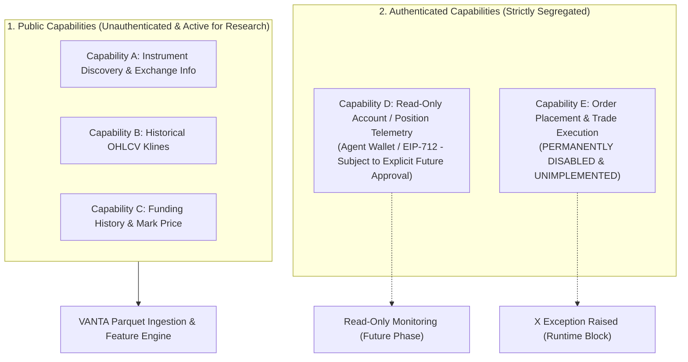

# AsterDEX Futures V3 (Pro API) — Integration Specification
**Document ID:** DOC-EXCHANGE-V3  
**Verified Date:** 2026-10-27  
**Official Repository:** [https://github.com/asterdex/api-docs](https://github.com/asterdex/api-docs)  
**Futures V3 Documentation:** [https://asterdex.github.io/aster-api-website/futures-v3/general-info/](https://asterdex.github.io/aster-api-website/futures-v3/general-info/)

---

## 1. Architectural Distinction: Pro API (V3) vs. Legacy V1

AsterDEX has modernized its infrastructure around the **Futures V3 / Pro API**. Legacy V1 API key creation has been formally deprecated. All new systems must align with the V3 architecture.

| Feature / Dimension | Legacy API (V1) [DEPRECATED] | Pro API (V3) [CURRENT TARGET] | VANTA Terminal Treatment |
| :--- | :--- | :--- | :--- |
| **API Version Status** | Deprecated key creation | Active standard for all integrations | **Target specification** |
| **Production Base URL** | `https://api.asterdex.io` | `https://fapi.asterdex.com` | Configured as primary in `.env.example` |
| **Testnet Base URL** | Varies | `https://fapi.asterdex-testnet.com` | Configured as testnet option |
| **Authentication Standard**| Legacy static HMAC-SHA256 | Authorized API Wallets / Agent Wallets (EIP-712) | Prepared for read-only agent wallet only |
| **Key Hierarchy** | Direct exchange API key | Separate Authorized Agent delegated by wallet | **Never use or request main wallet private key** |
| **Deposit Requirement** | Historical / legacy | Required for `TRADE` & `USER_DATA` endpoints | Public market data unaffected (no deposit required) |
| **Order Execution** | Legacy endpoints | V3 Signed Order endpoints | **PERMANENTLY UNIMPLEMENTED & DISABLED** |

---

## 2. Decoupled Capability Architecture

VANTA Terminal strictly decouples exchange operations into independent, air-gapped capabilities:

### Capability A: Public Market Data & Instrument Discovery
- **Endpoint**: `GET /fapi/v1/exchangeInfo` (or `/fapi/v3/exchangeInfo`)
- **Authentication**: None required.
- **Responsibilities**:
  - Discover valid native trading symbol representations (e.g. `BTCUSDT` or `BTCUSDT.P`).
  - Contract specifications (tick size, lot size, min notional, price precision).
  - Rate limit tiers and request weight headers.

### Capability B: Historical OHLCV Retrieval
- **Endpoint**: `GET /fapi/v1/klines` (or `/fapi/v3/klines`)
- **Authentication**: None required.
- **Query Parameters**:
  - `symbol`: e.g. `BTCUSDT`
  - `interval`: `15m`, `1h`, `4h`
  - `startTime`: Milliseconds unix timestamp
  - `endTime`: Milliseconds unix timestamp
  - `limit`: Default 500, max 1000 per request
- **Ordering**: Returns ascending chronological series (oldest to newest).

### Capability C: Funding Rate & Mark Price History
- **Endpoints**:
  - `GET /fapi/v1/fundingRate` (historical 8-hour funding rate events)
  - `GET /fapi/v1/premiumIndex` (current mark price and funding rate estimate)
- **Authentication**: None required.
- **Responsibilities**: Provide point-in-time funding payment records for realistic futures backtesting.

### Capability D: Authenticated Read-Only Account Data (Future Phase Stubs)
- **Status**: **NOT IMPLEMENTED IN PHASE 1**.
- **Rules if approved in a future phase**:
  - Must use a separately authorized **API Wallet / Agent** with minimum permissions.
  - Withdrawal permissions must be **permanently disabled**.
  - **Never store or request a main-wallet private key**.
  - Keys stored exclusively in local `.env` (git-ignored), never printed in logs, console, or UI.

### Capability E: Order Execution
- **Status**: **PERMANENTLY UNIMPLEMENTED & DISABLED**.
- Order routing code is physically absent. The adapter raises `RuntimeError("Order execution is permanently disabled in VANTA Terminal.")`.

---

## 3. Phase 2 Verification & Coverage Audit Protocol

Before downloading bulk historical candles in Phase 2:
1. **Query Exchange Information**:
   - Check which of the 11 target pairs are active on AsterDEX Futures V3.
   - Verify native symbol naming convention.
2. **Coverage Audit per Pair**:
   - Query earliest available candle timestamp via binary search or pagination from listing date.
   - Document whether 3 years of data exists or what the true verified history is.
   - **Never interpolate or substitute synthetic candles for missing exchange history.**
3. **Data Quality Tear Sheet**:
   - Generate `artifacts/reports/ASTERDEX_COVERAGE_REPORT.md` and present to user for review before any downloads.

---

## 4. UI Indicators Specification

The terminal interface must visibly communicate the data source and operating mode:
- **Badge 1**: `ASTERDEX FUTURES V3`
- **Badge 2**: `PUBLIC DATA ONLY`
- **Badge 3**: `LOCAL RESEARCH · NO LIVE ORDERS`
