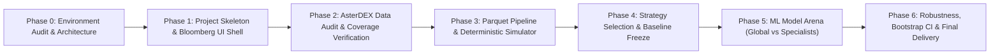

# VANTA Terminal — Phased Implementation Plan
**Document ID:** DOC-PLAN-001  
**Target Environment:** Windows 10/11 x64 · 16 GB RAM (3.5 GB Available) · GTX 1050 Ti · Intel i7-7700HQ  
**Workspace Root:** `D:\vanta-terminal\` (NTFS Junction with `D:\VANTA Terminal\`)  
**Strict Safety Lock:** Local Research Workstation · Zero Live Order Placement Routing

---

## Roadmap Overview

---

## PHASE 0 — Environment and Design Audit (CURRENT)
**Objective:** Verify physical constraints, drive space, port allocations, and runtime tools; establish design documents and architecture without triggering heavy downloads or model execution.

### Tasks:
- [x] Inspect C: and D: drive capacities.
- [x] Verify Python (3.13.7) and Node.js (v22.19.0) versions and tools.
- [x] Scan listening TCP ports; verify Port 8000 is occupied by external PID 5328 and strictly forbidden.
- [x] Verify availability of Port 8101 (Backend) and Port 3000 (Frontend) on `127.0.0.1`.
- [x] Inspect physical RAM (15.89 GB Total, 3.50 GB Free); establish low-memory execution limits.
- [x] Create NTFS directory junction `D:\vanta-terminal` $\leftrightarrow$ `D:\VANTA Terminal`.
- [x] Initialize Git repository with safe `.gitignore` (blocking parquet, models, venv, node_modules).
- [x] Draft `docs/PORTS_AND_RUNTIME.md`, `docs/ARCHITECTURE.md`, `docs/IMPLEMENTATION_PLAN.md`.
- [x] Present audit findings and request formal approval before Phase 1.

### Exit Criteria:
- No foreign process interrupted.
- Ports 8101 and 3000 confirmed available.
- Phase 0 documentation committed.
- Explicit approval checkpoint provided.

---

## PHASE 1 — UI Shell and Project Skeleton
**Objective:** Construct a fully operational local UI shell and backend API skeleton using realistic demo fixtures, establishing the Bloomberg terminal visual identity and verifying process control scripts.

### Tasks:
1. **Local Backend Skeleton (`backend/`):**
   - FastAPI application instance bound to `127.0.0.1:8101`.
   - Endpoints:
     - `GET /health`: System telemetry, CPU/RAM usage, worker state.
     - `GET /api/v1/overview`: Summary stats with explicit `is_demo_data: true`.
     - `GET /api/v1/pairs`: 11 crypto-futures pairs metadata and coverage status.
     - `GET /api/v1/experiments`: Recent runs, configuration hashes, job queue.
     - `GET /api/v1/system`: Detailed resource metrics and port confirmation.
   - Pydantic v2 schemas for all contracts.
   - Lightweight SQLite job registry initialization (`experiments/vanta.sqlite`).

2. **Bloomberg-Inspired Frontend (`frontend/`):**
   - Next.js 14/15 App Router with Tailwind CSS.
   - Professional dark graphite theme (`#0B0D13`), subtle slate panel borders, amber accent (`#F59E0B`).
   - Persistent top status bar:
     - `LOCAL RESEARCH · NO LIVE ORDERS` watermark badge.
     - Backend connectivity heartbeat & latency indicator.
     - Active worker status indicator.
     - System memory & CPU usage pill.
     - Prominent `DEMO DATA ACTIVE` pill.
   - Persistent left sidebar navigation:
     - Terminal Overview
     - Pair Monitor
     - Pair Explorer (with TradingView Lightweight Charts integration)
     - Strategy Lab
     - Model Arena
     - Experiment Center
     - Data Center
     - System Monitor
   - Dense, fixed-width numeric tables with tabular numerals.

3. **Operational Scripts (`scripts/`):**
   - `scripts/start.ps1`: Safe launch script checking ports, starting backend and frontend, and logging PIDs to `.runtime/`.
   - `scripts/stop.ps1`: Targeted shutdown script killing only VANTA PIDs without touching system Python/Node tasks.
   - `scripts/health_check.ps1`: Connectivity and memory telemetry verification.

4. **Verification & Testing:**
   - Pytest API tests (`tests/test_api_health.py`).
   - Frontend build and smoke tests.
   - Verify zero contact with port 8000.

### Exit Criteria:
- Frontend renders all 8 terminal pages seamlessly at `http://127.0.0.1:3000`.
- Backend documentation accessible at `http://127.0.0.1:8101/docs`.
- Clean start and stop cycle tested via PowerShell scripts.

---

## PHASE 2 — AsterDEX Data Audit & Coverage Verification
**Objective:** Build the AsterDEX exchange adapter and audit symbol metadata, historical coverage, and endpoint limits **before** downloading any datasets.

### Tasks:
1. **Exchange Adapter (`backend/data/asterdex_adapter.py`):**
   - Public endpoint integration (no API keys required).
   - Symbol verification against native exchange instruments:
     - `BTCUSDT.P`, `ETHUSDT.P`, `SOLUSDT.P`, `BNBUSDT.P`, `XRPUSDT.P`,
     - `ADAUSDT.P`, `AVAXUSDT.P`, `LINKUSDT.P`, `DOGEUSDT.P`, `LTCUSDT.P`, `XMRUSDT.P`.
   - Query contract specifications, tick sizes, step sizes, and settlement rules.
2. **Coverage Audit Script (`backend/data/coverage_audit.py`):**
   - Discover earliest available candle per symbol on `15m`, `1H`, `4H`.
   - Check funding rate and mark price endpoint history.
   - Detect rate limits, maximum batch size per request, and pagination headers.
   - Measure actual historical depth (verifying whether 3 years is available or what gap exists).
3. **Data Quality Report (`artifacts/reports/DATA_COVERAGE_REPORT.md`):**
   - Detailed audit matrix per pair and timeframe.
   - Document any unlisted pairs or truncated histories.
   - Prohibit synthetic candle interpolation.

### Exit Criteria:
- Comprehensive audit report generated.
- Strict review before any bulk downloading commences.

---

## PHASE 3 — Parquet Data Pipeline & Deterministic Simulator
**Objective:** Implement high-speed, low-memory Parquet ingestion, validation routines, and a deterministic event-driven backtesting engine.

### Tasks:
1. **Data Pipeline & Storage (`backend/data/`):**
   - Polars streaming reader/writer saving to `data/raw/{symbol}/{timeframe}.parquet`.
   - SHA-256 JSON manifest generator with candle count, start/end timestamps, and hash.
   - Gap detection and candle sequence validation.
2. **Point-in-Time Feature Engine (`backend/features/`):**
   - Polars lazy transforms for price action, volatility, and volume indicators.
   - Backward `asof` joins for multi-timeframe features (preventing high-timeframe leak).
3. **Deterministic Backtesting Simulator (`backend/backtest/`):**
   - Event-driven execution loop.
   - Realistic transaction costs: Maker ($0.02\%$), Taker ($0.05\%$), slippage model ($2\text{ bps} + \text{impact}$).
   - 8-hour funding payment debits/credits.
   - Conservative same-candle TP/SL conflict resolution (Stop Loss triggers first).
4. **Testing Suite (`tests/`):**
   - Test candle ordering and duplicate timestamp rejection.
   - Test zero look-ahead bias in feature computation.
   - Test determinism: running the identical backtest 5 times yields identical trade ledgers down to 8 decimal places.

### Exit Criteria:
- Data pipeline passes all integrity checks.
- Backtest engine deterministic tests pass with 100% assertions.

---

## PHASE 4 — Strategy Validation & Freeze
**Objective:** Implement and benchmark the three candidate strategy families, selecting and freezing a single candidate prior to ML model exploration.

### Tasks:
1. **Strategy Implementations (`backend/strategies/`):**
   - **Sweep-Reclaim**: Liquidity sweep detection + close inside range + ATR stop.
   - **Breakout / Trend-Following**: Dynamic channel break + volume expansion + trailing exit.
   - **Mean Reversion**: Statistical price displacement ($|Z| \ge 2.5$) + deceleration entry.
2. **Controlled Walk-Forward Benchmark:**
   - Identical chronological train/validation splits across all 11 pairs.
   - Identical cost model and risk budget (1% capital risk per trade).
3. **Strategy Comparison Tear Sheet (`artifacts/reports/STRATEGY_SELECTION_REPORT.md`):**
   - Metrics: Net PnL, Max Drawdown, Sharpe, Sortino, Win Rate, Profit Factor, Trade Count.
   - Pre-qualification check: Minimum 100 trades, Sharpe $\ge 1.0$, Max DD $\le 25\%$.
   - If no strategy passes $\implies$ Output `NO QUALIFIED STRATEGY`.
4. **Strategy Freeze:**
   - Freeze the chosen strategy's rules, indicators, and parameters with an immutable configuration hash.

### Exit Criteria:
- Formal strategy selection report generated.
- Candidate strategy frozen; no further modifications allowed during ML phases.

---

## PHASE 5 — Machine Learning Model Arena
**Objective:** Train and evaluate three ML configurations using the frozen strategy's triple-barrier labels.

### Tasks:
1. **Labeling Engine (`backend/labels/`):**
   - Volatility-adjusted triple-barrier labeling (TP, SL, Expiry).
   - Point-in-time barrier crossing logic.
2. **Model Implementations (`backend/models/`):**
   - **Configuration A (Global Model)**: LightGBM/XGBoost pooled across all pairs with pair identifiers.
   - **Configuration B (Pair Specialists)**: 11 distinct models trained strictly on native pair data.
   - **Configuration C (Global + Pair Calibration)**: Pooled global model with pair-specific isotonic probability calibration fitted on validation fold.
3. **Low-Memory Training Pipeline:**
   - Sequential training (one model at a time, `n_jobs=2`).
   - Explicit garbage collection and memory release.
4. **Evaluation & Model Arena Dashboard:**
   - Chronological validation comparison.
   - Brier score, calibration curves, ROC-AUC, Precision-Recall.
   - Model Arena page displaying real-time comparisons.

### Exit Criteria:
- All three configurations trained and evaluated on validation folds.
- Model artifacts serialized with companion metadata manifests.

---

## PHASE 6 — Statistical Robustness & Final Reporting
**Objective:** Perform final untouched Out-Of-Sample (OOS) testing, statistical block-bootstrap analysis, and complete platform documentation.

### Tasks:
1. **Untouched OOS Evaluation:**
   - Single forward pass on the frozen test holdout split.
   - Zero parameter or threshold refitting.
2. **Statistical Robustness (`backend/evaluation/bootstrap.py`):**
   - 1,000-iteration stationary block-bootstrap confidence intervals for Sharpe, MDD, and expectancy.
   - Regime shift stability analysis.
3. **Final Delivery Artifacts:**
   - Comprehensive research tear sheet (`artifacts/reports/VANTA_FINAL_RESEARCH_REPORT.md`).
   - SQLite experiment history database.
   - Comprehensive `README.md` and user manual.

### Exit Criteria:
- Complete end-to-end reproducibility verified from raw data to final report.
- All test suites passing.
