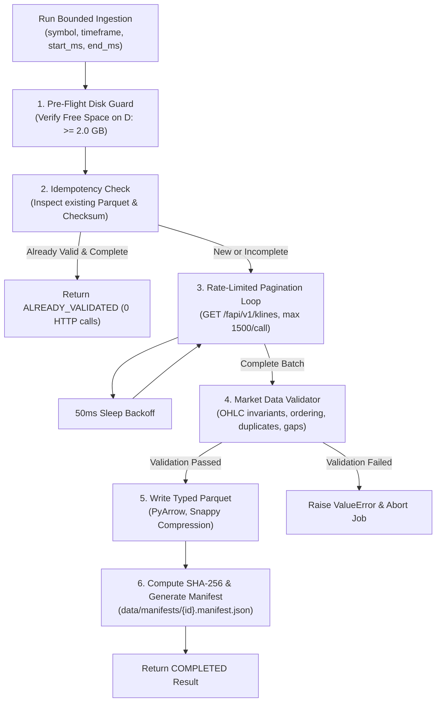

# VANTA Terminal — Ingestion Pipeline & Parquet Architecture Design
**Document ID:** DOC-INGEST-DESIGN-001  
**Phase:** 3A (Bounded Ingestion & Integrity Validation)  
**Verification Date:** 2026-10-27  

---

## 1. Architectural Principles

1. **Strictly Sequential Single-Worker Architecture**:
   To honor the laptop's ~3.5 GB available RAM budget and single-threaded worker rule (`VANTA_MAX_WORKERS=1`), ingestion processes exactly one symbol and one timeframe at a time. Parallel multi-pair downloads are structurally prohibited.
2. **HDD Storage Isolation**:
   All raw Parquet files are written to `D:\vanta-terminal\data\raw\{symbol}\{timeframe}.parquet`. NVMe SSD C: usage is strictly 0.0 MB.
3. **Zero Lookahead & Point-in-Time Correctness**:
   Candles are stored strictly by `open_time` (unix ms) and `close_time` (inclusive unix ms). Feature extraction consumes only historical candles with $t_{\text{close}} \le t_{\text{decision}}$.
4. **Zero Fabrication**:
   No synthetic interpolation, forward-filling, or third-party exchange data substitution is permitted. If an exchange interval is missing, it is recorded in the manifest as a gap.
5. **Idempotent Resume & Checksum Verification**:
   If a valid Parquet dataset already exists and covers the requested window, re-running the job returns `ALREADY_VALIDATED` immediately without redundant network calls.

---

## 2. Ingestion Flow & Component Architecture

---

## 3. Strongly-Typed Parquet Storage Schema

Datasets are written as Apache Parquet files using PyArrow with the following schema:

| Column Name | Arrow Type | Physical Representation | Description |
| :--- | :--- | :--- | :--- |
| `open_time` | `int64` | `pa.int64()` | Candle opening timestamp in UTC unix milliseconds |
| `open` | `float64` | `pa.float64()` | Opening price |
| `high` | `float64` | `pa.float64()` | Period highest traded price |
| `low` | `float64` | `pa.float64()` | Period lowest traded price |
| `close` | `float64` | `pa.float64()` | Period closing price |
| `volume` | `float64` | `pa.float64()` | Base asset trading volume |
| `close_time` | `int64` | `pa.int64()` | Candle close timestamp in UTC unix milliseconds (inclusive) |
| `quote_volume` | `float64` | `pa.float64()` | Quote asset trading volume (USDT) |
| `trades_count` | `int64` | `pa.int64()` | Total trade fills executed in period |
| `taker_buy_base` | `float64` | `pa.float64()` | Aggressive market taker buy base volume |
| `taker_buy_quote`| `float64` | `pa.float64()` | Aggressive market taker buy quote volume |

Compression codec: **`SNAPPY`** (Optimal balance between high decompression throughput and compact storage).

---

## 4. Mathematical Validation Invariants

Every ingested batch passes deterministic validation checks prior to Parquet serialization:

1. **OHLC Relations**:
   $$\text{High} \ge \max(\text{Open}, \text{Close})$$
   $$\text{Low} \le \min(\text{Open}, \text{Close})$$
   $$\text{High} \ge \text{Low} > 0$$
   $$\text{Volume} \ge 0$$
2. **Strict Chronological Sequence**:
   $$t_{i} > t_{i-1} \quad \forall i \in [1, N]$$
3. **Duplicate Rejection**:
   $$| \{ t_i \} | = N$$
4. **Timeframe Modular Alignment**:
   $$t_i \pmod{\Delta t} = 0$$
   Where $\Delta t = 900,000\text{ ms}$ for 15m, $3,600,000\text{ ms}$ for 1H, and $14,400,000\text{ ms}$ for 4H.
5. **Gap Detection**:
   $$\text{Gap} \iff (t_i - t_{i-1}) > \Delta t$$
   Any gap records start time, end time, and exact missing bar count.
