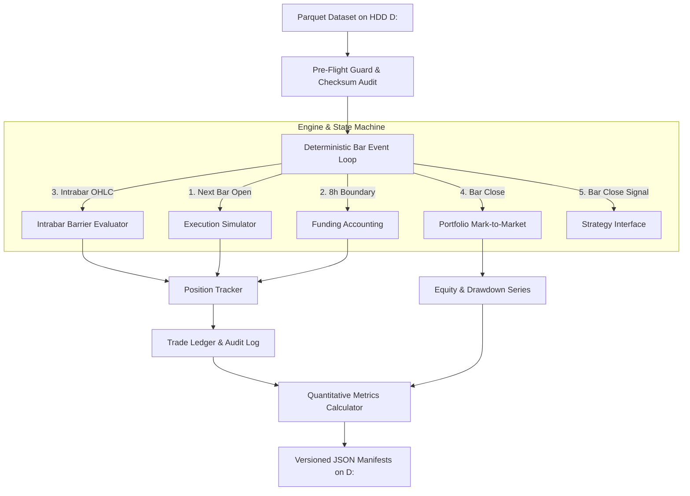
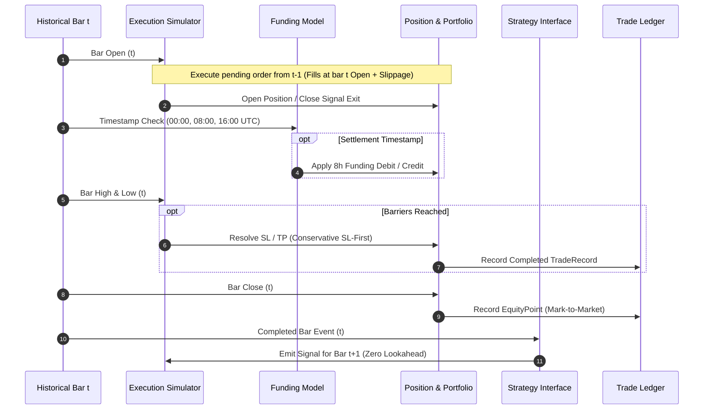

# VANTA Terminal — Backtest Engine Architecture & System Design
**Document ID:** DOC-DESIGN-P3B2  
**Phase:** 3B.2 (Deterministic Event-Driven Backtesting Engine)  
**Verification Date:** 2026-10-27  

---

## 1. Modular Architectural Overview

VANTA Terminal's backtesting infrastructure is architected as an event-driven, vector-indexed discrete simulation state machine. To maintain maintainability and testability, responsibilities are cleanly decoupled into dedicated modules under `backend/backtest/`:

### Module Responsibilities:
- `backend/backtest/schemas.py`: Pydantic v2 schemas, configuration models, deterministic hashing (`compute_config_hash()`), trade records, and run summaries.
- `backend/backtest/events.py`: Immutable event dataclasses (`BarEvent`, `SignalEvent`, `OrderEvent`, `FillEvent`, `FundingEvent`).
- `backend/backtest/costs.py`: Maker/taker fee calculations and market order slippage modeling.
- `backend/backtest/funding.py`: 8-hour funding cashflows and prerequisite blocking logic (`BLOCKED_MISSING_FUNDING_DATA`).
- `backend/backtest/position.py`: Lifecycle management of active long/short perpetual contracts.
- `backend/backtest/portfolio.py`: Cash, equity, margin requirements, sizing methods, and high-watermark drawdown.
- `backend/backtest/execution.py`: Fill simulation, gap-through-stop protection, and conservative same-candle barrier resolution.
- `backend/backtest/ledger.py`: In-memory ledger collection, atomic JSON serialization, and immutable run manifests.
- `backend/backtest/metrics.py`: Net PnL, Win Rate, Expectancy, Profit Factor, Max Drawdown, and annualized Sharpe/Sortino ratios.
- `backend/backtest/engine.py`: Orchestrating event loop, zero-lookahead enforcement, and strategy interfaces.

---

## 2. Discrete Event State Machine & Bar Lifecycle

On each chronological bar $t$:

---

## 3. Storage & Artifact Isolation

All backtest runs, trade ledgers, and equity curves are stored strictly on HDD `D:\` under `data/backtests/{run_id}/`:
- `result.json`: Complete `BacktestResult` payload with performance metrics and cost breakdown.
- `trade_ledger.json`: Structured array of every completed trade.
- `equity_curve.json`: Bar-by-bar mark-to-market equity, cash, unrealized PnL, and drawdown series.
- `run_manifest.json`: Immutable audit manifest recording dataset ID, dataset SHA-256, config hash, and result file checksum.

NVMe SSD C: footprint remains strictly **`0.0 MB`**.
Operational safety reserve on D: is enforced at $\ge 10.0\text{ GB}$.
