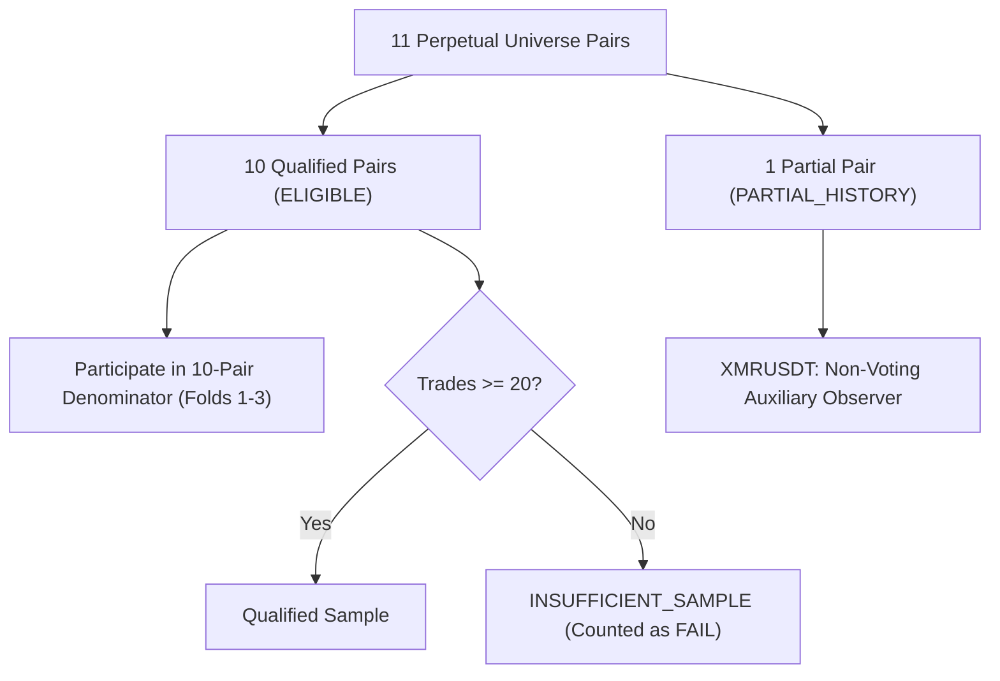

# VANTA Terminal — Phase 4A.1 Protocol Integrity Audit
**Document ID:** AUD-P4A1-001  
**Phase:** 4A.1 (Methodology Correction & Protocol Audit)  
**Execution Date:** 2026-10-27  
**Status:** COMPLETE · PROTOCOL RECONCILED & FROZEN  

---

## 1. Executive Summary & Audit Mandate

Prior to authorizing candidate strategy benchmarks in Phase 4B, this audit reviews and resolves all potential ambiguities, contradictions, and methodological risks identified in the Phase 4A research protocol.

This is a **pure methodology and documentation reconciliation checkpoint**. In strict adherence to operational constraints:
- **No candidate strategy benchmarks** were executed.
- **No ML models** were trained or initialized.
- **Quarantined holdout data** remains physically sealed and uninspected.
- **No historical funding data** was bulk-downloaded or ingested.
- **Forbidden Port 8000** (PID 24852) remains completely untouched.
- Services remain bound strictly to loopback `127.0.0.1`.
- Live order execution remains physically non-existent.

---

## 2. Review Dimension 1: Holdout Quarantine Integrity

### 2.1 Resolution of Apparent Contradiction
In the initial Phase 4A draft, an apparent contradiction was identified between:
1. *Mandate A*: "The final 6 months of historical data are strictly quarantined... No backtest, optimization, parameter scan, indicator tuning, or model selection may touch this range during Phase 4 or Phase 5."
2. *Statement B*: "In Holdout: 2026-04-26 to 2026-10-26 (full 6-month holdout evaluation) for XMRUSDT."

**Reconciliation & Frozen Rule**:
- The holdout period: **`2026-04-26 00:00:00 UTC` to `2026-10-26 00:00:00 UTC` ($183\text{ days}$)** is an **absolute, universe-wide quarantine**.
- Under **NO circumstances** is `XMRUSDT` (or any other pair) evaluated, inspected, simulated, or ranked in the holdout window during Phase 4 (Candidate Strategy Benchmarking) or Phase 5 (ML Model Arena).
- The holdout partition is strictly quarantined until authorized for the one-shot Out-Of-Sample Final Audit in Phase 6.

### 2.2 Handling of `XMRUSDT` Pre-Quarantine History
- `XMRUSDT` verified AsterDEX listing date: `2026-01-13 16:45:00 UTC`.
- Prior to the holdout quarantine boundary (`2026-04-26 00:00:00 UTC`), `XMRUSDT` possesses exactly **$103\text{ days}$** of historical data ($9,888\text{ bars}$ on 15m).
- In Folds 1 and 2, `XMRUSDT` did not exist on AsterDEX.
- In Fold 3, the In-Sample period is `2024-10-26` to `2025-10-26`, during which `XMRUSDT` also did not exist.
- Therefore, `XMRUSDT` has **zero In-Sample data** for training or parameter optimization in all three walk-forward folds.
- **Frozen Protocol**: `XMRUSDT` is classified as **`PARTIAL_HISTORY`**. It is excluded from the primary qualification gate denominator. Its $103\text{ days}$ of pre-quarantine OOS data in Fold 3 is tracked strictly as an unranked, non-voting exploratory observer.

---

## 3. Review Dimension 2: Walk-Forward Protocol Precision

### 3.1 Rolling vs. Expanding Clarification
- The walk-forward architecture is formally designated as **Rolling (Fixed-Length 12-Month In-Sample, 6-Month Out-Of-Sample)**.
- Step shift: Exactly $6\text{ months}$ between folds.
- **Statistical Independence Clarification**:
  - The In-Sample training windows shift by 6 months while spanning 12 months, resulting in an exact **$50\%$ chronological overlap** between adjacent In-Sample windows.
  - While the Out-of-Sample validation windows are **strictly non-overlapping in time**:
    - OOS Fold 1: `2024-10-26 06:00:00` to `2025-04-26 00:00:00 UTC` ($182\text{ days}$)
    - OOS Fold 2: `2025-04-26 06:00:00` to `2025-10-26 00:00:00 UTC` ($183\text{ days}$)
    - OOS Fold 3: `2025-10-26 06:00:00` to `2026-04-26 00:00:00 UTC` ($182\text{ days}$)
  - Because parameters $\theta^*_1, \theta^*_2, \theta^*_3$ are estimated from partially overlapping in-sample training sets, the resulting OOS performance observations **must NOT be treated as independent and identically distributed (i.i.d.) random variables**.
  - Standard errors and hypothesis tests across folds must account for autocorrelation.

### 3.2 Purge Window vs. Maximum Holding Duration
- In Phase 4A, the purge window was specified as 24 bars (6 hours on 15m). However, Strategy B (Donchian Breakout on 1H) has a maximum holding duration of $48\text{ bars} = 48\text{ hours}$. A 6-hour purge would allow a 48-hour trade initiated during In-Sample to overlap into Out-of-Sample.
- **Reconciliation & Frozen Rule**:
  - The universal Purge Window is standardized to **$48.0\text{ hours}$ (192 bars on 15m, 48 bars on 1H)** across all candidates and timeframes.
  - At timestamp $T_{split} - 48\text{h}$, signal generation for In-Sample evaluation is permanently stopped.
  - Any trade still open at $T_{split}$ is forcefully closed at the final completed bar of the In-Sample period and recorded in the IS ledger with exit reason `BOUNDARY_FLAT`.
  - Zero open positions, zero unrealized PnL, and zero pending orders carry across the split boundary.
  - The Out-of-Sample simulation starts from a clean $100\%$ cash state.
  - An Embargo period of **$48\text{ hours}$** is enforced at the start of Out-of-Sample to burn-in all moving averages, indicators, and ATR buffers. No trade may be entered until $T_{split} + 48\text{h}$.

---

## 4. Review Dimension 3: Eligible Pair Universe & Spatial Robustness Denominator

### 4.1 Lifecycle Categorization of the 11-Pair Universe
Every instrument in `backend/api/pairs.py` is assigned one of three mutual lifecycle states:

1. **`ELIGIBLE` (10 Qualified Pairs)**:
   - `BTCUSDT`, `ETHUSDT`, `SOLUSDT`, `BNBUSDT`, `XRPUSDT`, `ADAUSDT`, `AVAXUSDT`, `LINKUSDT`, `DOGEUSDT`, `LTCUSDT`.
   - Verified historical depth: $\ge 3\text{ years}$ ($105,216\text{ bars}$ on 15m).
   - Fully active across all 3 Walk-Forward Folds.
2. **`PARTIAL_HISTORY` (`XMRUSDT`)**:
   - Verified historical depth: $286\text{ days}$ ($27,389\text{ bars}$ on 15m).
   - In-Sample history in Folds 1–3: $0\text{ days}$.
   - Pre-quarantine OOS history: $103\text{ days}$ (Fold 3 tail only).
   - Status: Non-voting exploratory observer.
3. **`INSUFFICIENT_SAMPLE`**:
   - Any qualified pair producing $< 20\text{ completed trades}$ across the 3 OOS folds is flagged as `INSUFFICIENT_SAMPLE`.

### 4.2 Resolution of the Spatial Robustness Denominator
- In Phase 4A, GATE-7 required "positive net PnL in $\ge 7\text{ of } 11\text{ pairs}$."
- Because `XMRUSDT` has zero presence in Folds 1 and 2, using an 11-pair denominator would mechanically penalize candidates by treating absent pairs as failures, or require ad-hoc conditional logic.
- **Reconciliation & Frozen Rule**:
  - The Spatial Robustness Gate (GATE-7) denominator is **frozen strictly at the 10 `ELIGIBLE` Qualified Pairs**:
    $$\text{Cross-Pair Robustness} \equiv \sum_{k \in \text{QualifiedPairs}} \mathbb{I}(\text{Net PnL}_{OOS, k} > 0) \ge 7 \text{ of } 10 \text{ Pairs } (70.0\%)$$
  - `XMRUSDT` is evaluated separately as an exploratory metric and does NOT contribute to passing or failing GATE-7.
  - If an eligible pair generates $0$ trades or is flagged as `INSUFFICIENT_SAMPLE`, it is counted strictly as **$\text{Net PnL} \le 0$ (FAIL)**. Ineligible or low-activity pairs cannot be excluded to inflate win rates.

---

## 5. Review Dimension 4: Accounting, Friction & Expectancy Mechanics

### 5.1 Independent Symmetric Friction Application
- Taker fees and adverse slippage are applied **independently and symmetrically** to both Entry and Exit:
  $$\text{Fill Price}_{entry} = Open_{t+1} \times (1 \pm \text{Slippage})$$
  $$\text{Fee}_{entry} = \text{Fill Price}_{entry} \times \text{Quantity} \times \text{Taker Fee Rate}$$
  $$\text{Fill Price}_{exit} = Open_{t+k} \times (1 \mp \text{Slippage})$$
  $$\text{Fee}_{exit} = \text{Fill Price}_{exit} \times \text{Quantity} \times \text{Taker Fee Rate}$$
- Where Taker Fee Rate = $0.0005$ ($5.0\text{ bps}$) and Slippage Rate = $0.0002$ ($2.0\text{ bps}$).
- Round-trip frictional drag on trade notional is exactly **$14.0\text{ bps}$ ($0.14\%$)**.
- This matches the verified engine code in [`backend/backtest/execution.py`](file:///d:/vanta-terminal/backend/backtest/execution.py) and test assertions in [`tests/test_engine_accounting_audit.py`](file:///d:/vanta-terminal/tests/test_engine_accounting_audit.py).

### 5.2 Expectancy Denominator Formalization
- **Primary Expectancy ($\mathbb{E}[r]$)**: Defined strictly relative to **Trade Entry Notional**:
  $$r_i = \frac{\text{Net Realized PnL}_i}{\text{Entry Fill Price}_i \times \text{Quantity}_i}$$
  $$\mathbb{E}[r] = \frac{1}{N}\sum_{i=1}^N r_i$$
  Hurdle: $\mathbb{E}[r] \ge +0.0008$ ($+8.0\text{ bps}$).
- **Secondary $R$-Expectancy ($\mathbb{E}[R]$)**: Defined relative to initial trade risk (Stop Loss distance):
  $$R_i = \frac{\text{Net Realized PnL}_i}{|\text{Entry Fill Price}_i - \text{SL}_i| \times \text{Quantity}_i}$$
  $$\mathbb{E}[R] = \frac{1}{N}\sum_{i=1}^N R_i$$

### 5.3 Funding Disclaimer & Result Labeling
All tear sheets, API outputs, and UI displays for Phase 4 benchmarks must carry the mandatory label:
> `COST_MODEL: TAKER_5BPS_SLIPPAGE_2BPS (FUNDING_EXCLUDED_BASELINE)`  
> *NOTICE: Results reflect standard taker fees and adverse slippage but strictly EXCLUDE perpetual funding payments. These figures must NOT be interpreted as fully funding-adjusted futures profitability.*

### 5.4 Position Sizing and Reset Mechanics
- Position Sizing: Fixed fractional risk of **$10.0\%$ of available equity** allocated per trade.
- Maximum Leverage: **$1.0\times$** (cash margin equivalence).
- Equity Reset: Initial equity ($\$10,000.00\text{ USDT}$) is reset to base capital at the start of each Out-of-Sample fold to eliminate cross-fold compounding distortion.

---

## 6. Review Dimension 5: Statistical Qualification Gates & Stress Testing

### 6.1 Exact Mathematical Formulas

1. **Net Expectancy ($\mathbb{E}[r]$)**:
   $$\mathbb{E}[r] = \frac{1}{N}\sum_{i=1}^N \frac{\text{Net PnL}_i}{\text{Notional}_i}$$
   95% Confidence Interval:
   $$\text{CI}_{95\%} = \mathbb{E}[r] \pm t_{0.975, N-1} \times \frac{s_r}{\sqrt{N}}$$

2. **Profit Factor (PF)**:
   $$\text{PF} = \frac{\sum_{i: \text{Net PnL}_i > 0} \text{Net PnL}_i}{\sum_{i: \text{Net PnL}_i < 0} |\text{Net PnL}_i|}$$
   If total loss $= 0$ and total win $> 0$, $\text{PF} = \infty$. If total win $= 0$, $\text{PF} = 0.0$.

3. **Maximum Drawdown (MDD)**:
   $$\text{MDD} = \max_{t \in [0, T]} \left( \frac{\max_{\tau \le t} E_\tau - E_t}{\max_{\tau \le t} E_\tau} \right) \times 100\%$$

4. **Fold Profitability**:
   $$\text{Fold } m \text{ Profitable} \iff \sum_{i \in \text{OOS}_m} \text{Net PnL}_i > 0$$

### 6.2 Clarification of Friction Stress Test (GATE-8)
- The stress test **REPLACES** the baseline friction parameters; it does NOT add to them.
- Baseline: Taker Fee = $5.0\text{ bps}$, Slippage = $2.0\text{ bps}$ ($14.0\text{ bps}$ round-trip).
- Stress Test: Taker Fee = $7.5\text{ bps}$ ($1.5\times$), Slippage = $3.0\text{ bps}$ ($1.5\times$).
- Total Stress Friction = **$21.0\text{ bps}$ ($0.21\%$) round-trip**.
- Evaluates the identical trade entry/exit sequence under the elevated cost parameters.

---

## 7. Review Dimension 6: Strategy Specification Determinism

### 7.1 Ambiguity Resolution in Candidate Specifications

1. **Strategy A (Sweep-Reclaim)**:
   - **Simultaneous / Outside Bar Conflict**: If a single candle $t$ sweeps both $L_{ref}(t)$ and $H_{ref}(t)$, signal generation is **REJECTED** (`SIGNAL_REJECTED_OUTSIDE_BAR_CONFLICT`). Indeterminate order book flow within extreme range expansion bars cannot be resolved causally on bar data alone.
   - **Burn-In Initialization**: Requires $\max(N, 14) + 14 = 34\text{ bars}$. Bars prior to index 34 are inactive.
   - **Barrier Conflict Precedence**: `CONSERVATIVE_SL_FIRST` (Stop Loss fills if both SL and TP are touched in the same bar).

2. **Strategy B (Donchian Breakout / Trend-Following)**:
   - **Stop Loss Definition**: In Phase 4A, the stop loss was ambiguously defined as $\max(\text{Fill Price} - 1.5\text{ ATR}, D_{mid})$. This allowed potential post-hoc selection.
   - **Frozen Resolution**: Stop Loss is deterministically fixed to:
     $$\text{SL}_{long} = \text{Fill Price} - 1.50 \times \text{ATR}_{14}(t)$$
     $$\text{SL}_{short} = \text{Fill Price} + 1.50 \times \text{ATR}_{14}(t)$$
     The Donchian Midline $D_{mid}$ functions strictly as the **Trailing Invalidation Exit** evaluated on completed candle Closes.
   - **Dual Channel Piercing**: If candle $t$ closes outside both channels (data corruption / extreme anomaly), signal is rejected.
   - **Burn-In Initialization**: Requires $\max(M, 50) + 14 = 64\text{ bars}$.

3. **Strategy C (Mean Reversion)**:
   - **Band Piercing Conflict**: If candle $t-1$ touches both upper and lower Bollinger Bands, signal is rejected.
   - **Burn-In Initialization**: Requires $\max(K_{len}, 14) + 14 = 34\text{ bars}$.

### 7.2 Pre-Registered 12-Configuration Grids

To prevent p-hacking, the parameter tuning search is frozen to exactly 12 pre-registered configurations per strategy:

#### Strategy A Grid:
| Config ID | Lookback $N$ | Sweep $\delta_{sweep}$ | $R:R$ Target | Timeframe |
| :--- | :--- | :--- | :--- | :--- |
| **A-01** (Default) | 20 | 0.10 | 2.0 | 15m |
| **A-02** | 20 | 0.05 | 2.0 | 15m |
| **A-03** | 20 | 0.15 | 2.0 | 15m |
| **A-04** | 15 | 0.10 | 2.0 | 15m |
| **A-05** | 30 | 0.10 | 2.0 | 15m |
| **A-06** | 20 | 0.10 | 1.5 | 15m |
| **A-07** | 20 | 0.10 | 2.5 | 15m |
| **A-08** | 15 | 0.05 | 1.5 | 15m |
| **A-09** | 15 | 0.15 | 2.5 | 15m |
| **A-10** | 30 | 0.05 | 1.5 | 15m |
| **A-11** | 30 | 0.15 | 2.5 | 15m |
| **A-12** | 20 | 0.08 | 2.2 | 15m |

#### Strategy B Grid:
| Config ID | Channel $M$ | Volume Multiplier $\gamma_{vol}$ | EMA Filter | Timeframe |
| :--- | :--- | :--- | :--- | :--- |
| **B-01** (Default) | 20 | 1.20 | 50 | 1H |
| **B-02** | 20 | 1.00 | 50 | 1H |
| **B-03** | 20 | 1.50 | 50 | 1H |
| **B-04** | 15 | 1.20 | 50 | 1H |
| **B-05** | 30 | 1.20 | 50 | 1H |
| **B-06** | 20 | 1.20 | 30 | 1H |
| **B-07** | 20 | 1.20 | 100 | 1H |
| **B-08** | 15 | 1.00 | 30 | 1H |
| **B-09** | 30 | 1.50 | 100 | 1H |
| **B-10** | 20 | 1.20 | 50 | 15m |
| **B-11** | 30 | 1.20 | 50 | 15m |
| **B-12** | 20 | 1.50 | 50 | 15m |

#### Strategy C Grid:
| Config ID | Band Length $K_{len}$ | Band Std $K_\sigma$ | RSI Thresholds | Timeframe |
| :--- | :--- | :--- | :--- | :--- |
| **C-01** (Default) | 20 | 2.0 | 30 / 70 | 15m |
| **C-02** | 20 | 1.8 | 30 / 70 | 15m |
| **C-03** | 20 | 2.2 | 30 / 70 | 15m |
| **C-04** | 15 | 2.0 | 30 / 70 | 15m |
| **C-05** | 25 | 2.0 | 30 / 70 | 15m |
| **C-06** | 20 | 2.0 | 25 / 75 | 15m |
| **C-07** | 20 | 2.0 | 35 / 65 | 15m |
| **C-08** | 15 | 1.8 | 25 / 75 | 15m |
| **C-09** | 15 | 2.2 | 35 / 65 | 15m |
| **C-10** | 25 | 1.8 | 25 / 75 | 15m |
| **C-11** | 25 | 2.2 | 35 / 65 | 15m |
| **C-12** | 20 | 2.1 | 28 / 72 | 15m |
