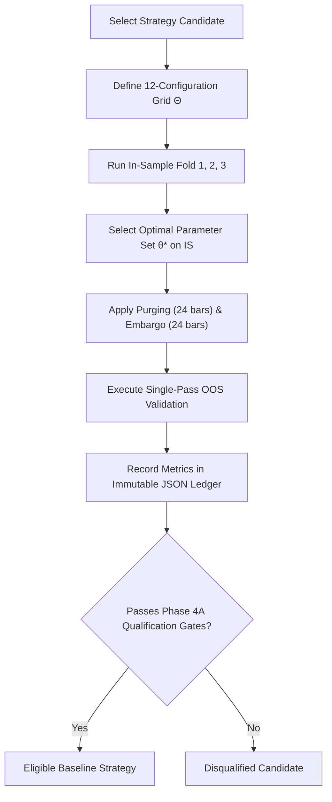

# VANTA Terminal — Walk-Forward Benchmark Protocol
**Document ID:** DOC-WFP-P4A-001  
**Phase:** 4A (Pre-Strategy Research Protocol)  
**Verification Date:** 2026-10-27  
**Status:** FROZEN PROTOCOL SPECIFICATION  

---

## 1. Executive Summary & Core Mandate

The primary vulnerability in quantitative crypto strategy research is **selection bias and data leakage** caused by:
1. In-sample overfitting through unrestricted parameter searches.
2. Contamination of out-of-sample test data via overlapping lookback windows or forward information flow.
3. Premature exposure of the test set during iterative strategy development.

To guarantee institutional-grade statistical rigor, this document pre-registers the **Walk-Forward Validation Protocol with Purging and Embargo** for VANTA Terminal across the 11-pair perpetual universe.

---

## 2. Chronological Universe Partitioning & Holdout Quarantine

### 2.1 The Untouched Test Set (Holdout Quarantine)
A fundamental rule of this platform is that **the final 6 months of historical data are strictly quarantined**:
- **Quarantine Period**: `2026-04-26 00:00:00 UTC` to `2026-10-26 00:00:00 UTC` ($183\text{ days}$).
- **Quarantine Rule**: No backtest, optimization, parameter scan, indicator tuning, or model selection may touch this range during Phase 4 or Phase 5.
- **Release Condition**: This window is reserved exclusively for the one-shot Out-Of-Sample Final Audit in Phase 6.

### 2.2 Walk-Forward Rolling Folds (10 Qualified Pairs)
For the 10 qualified pairs with complete 3-year history (`BTCUSDT`, `ETHUSDT`, `SOLUSDT`, `BNBUSDT`, `XRPUSDT`, `ADAUSDT`, `AVAXUSDT`, `LINKUSDT`, `DOGEUSDT`, `LTCUSDT`), the pre-quarantine history spans `2023-10-26 00:00:00 UTC` to `2026-04-26 00:00:00 UTC` ($913\text{ days}$).

We partition this period into three overlapping walk-forward folds with a fixed 12-month In-Sample (IS) training window and a consecutive 6-month Out-Of-Sample (OOS) validation window:

```
[--- 2023-10-26 ----------------------------- 2026-04-26 --------- 2026-10-26 ---]
Fold 1:  |==== IS 1 (12m) ====|--- OOS 1 (6m) ---|
Fold 2:         |==== IS 2 (12m) ====|--- OOS 2 (6m) ---|
Fold 3:                |==== IS 3 (12m) ====|--- OOS 3 (6m) ---|
Holdout (Phase 6):                                      |*** QUARANTINE (6m) ***|
```

#### Detailed Fold Schedule:
| Fold Name | Split Phase | Start Timestamp (UTC) | End Timestamp (UTC) | Duration | Candle Count (15m) |
| :--- | :--- | :--- | :--- | :--- | :--- |
| **Fold 1** | In-Sample (Train) | `2023-10-26 00:00:00` | `2024-10-26 00:00:00` | 366 days | 35,136 bars |
| | *Purge Window* | `2024-10-25 18:00:00` | `2024-10-26 00:00:00` | 6.0 hours | 24 bars purged |
| | Out-of-Sample (Val) | `2024-10-26 06:00:00` | `2025-04-26 00:00:00` | 182 days | 17,448 bars |
| **Fold 2** | In-Sample (Train) | `2024-04-26 00:00:00` | `2025-04-26 00:00:00` | 365 days | 35,040 bars |
| | *Purge Window* | `2025-04-25 18:00:00` | `2025-04-26 00:00:00` | 6.0 hours | 24 bars purged |
| | Out-of-Sample (Val) | `2025-04-26 06:00:00` | `2025-10-26 00:00:00` | 183 days | 17,544 bars |
| **Fold 3** | In-Sample (Train) | `2024-10-26 00:00:00` | `2025-10-26 00:00:00` | 365 days | 35,040 bars |
| | *Purge Window* | `2025-10-25 18:00:00` | `2025-10-26 00:00:00` | 6.0 hours | 24 bars purged |
| | Out-of-Sample (Val) | `2025-10-26 06:00:00` | `2026-04-26 00:00:00` | 182 days | 17,448 bars |
| **Holdout** | **Quarantined Test**| `2026-04-26 00:00:00` | `2026-10-26 00:00:00` | 183 days | 17,568 bars |

---

## 3. Asymmetric Pair Handling: `XMRUSDT` Protocol

### 3.1 Listing Asymmetry Analysis
- Verified historical coverage for `XMRUSDT` begins on `2026-01-13 16:45:00 UTC` ($286\text{ days}$ of validated data).
- The other 10 pairs have 1,096 days of history starting `2023-10-26 00:00:00 UTC`.

### 3.2 Non-Contamination Rule
1. **Zero Synthetic Back-Padding**: Synthetic data, cross-pair price interpolation, or zero-padding for `XMRUSDT` prior to `2026-01-13` is strictly prohibited.
2. **Fold 1 and Fold 2 Exclusion**: `XMRUSDT` is completely excluded from Fold 1 and Fold 2 walk-forward runs.
3. **Fold 3 Abbreviated In-Sample**: In Fold 3, `XMRUSDT` enters the in-sample universe on `2026-01-13 17:00:00 UTC` and contributes $103\text{ days}$ to the in-sample training pool before the `2026-04-26` boundary.
4. **Holdout Evaluation**: `XMRUSDT` participates fully in the 6-month quarantined test period (`2026-04-26` to `2026-10-26`).

---

## 4. Purging and Embargo Mathematics

To eliminate serial correlation and label overlap leakage between splits:

### 4.1 Purging Boundary Rule
Let $T_{split}$ be the exact timestamp separating In-Sample and Out-Of-Sample. Let $H_{max}$ be the maximum holding duration of the strategy ($24\text{ bars} = 6.0\text{ hours}$ for 15m; $48\text{ bars}$ for 1H).

- **Purge Window**:
  $$\text{Window}_{purge} = [T_{split} - H_{max} \cdot \Delta t, \; T_{split}]$$
- **Rule**: Any trade opened during $\text{Window}_{purge}$ in the In-Sample split is forcefully terminated at $T_{split}$, or signals occurring within this window are discarded. This guarantees that no trade initiated during In-Sample carries over into the Out-of-Sample period.

### 4.2 Embargo Boundary Rule
When indicators require an initial burn-in window (e.g., 50-period EMA or 20-period Donchian), evaluating them at the exact start of Out-of-Sample could cause cold-start distortion or inadvertent backward indexing.

- **Warm-Up Buffer**: The backtest engine warms up causal indicators using the trailing bars of the In-Sample period, but the trade ledger and metric collection only activate at $T_{split} + \text{Embargo}$.
- **Embargo Duration**: $E = 24\text{ bars}$ (6.0 hours on 15m). The first recorded trade in OOS may occur no earlier than $T_{split} + 24\text{ bars}$.

---

## 5. Parameter Tuning Budget & Anti-Overfitting Constraints

To safeguard against the *p-hacking* of backtests and false discovery:

1. **Strict Tuning Budget**: For each strategy candidate, a maximum of **12 parameter configurations** may be evaluated during the In-Sample phase.
2. **Deterministic Selection Criterion**: The optimal parameter set $\theta^*$ within the 12-configuration grid is selected using a single, pre-registered In-Sample objective function:
   $$\theta^* = \arg\max_{\theta \in \Theta} \left( \text{Sharpe Ratio}_{IS}(\theta) \times \min\left(1.0, \frac{N_{trades}(\theta)}{50}\right) \right)$$
   subject to $\text{Max Drawdown}_{IS}(\theta) \le 15.0\%$.
3. **One-Shot Out-of-Sample Run**: Once $\theta^*$ is selected from In-Sample, it is evaluated on the Out-of-Sample validation fold **exactly once**.
4. **Re-Tuning Ban**: Re-tuning parameters after inspecting OOS results is strictly prohibited. If $\theta^*$ fails the OOS qualification gates, the candidate fails that fold.

---

## 6. Execution Protocol Workflow


