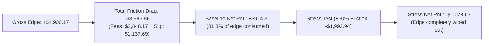

# VANTA Terminal — Phase 4B Benchmark Report
## Candidate Strategy Benchmark Execution, Evaluation & Freezing

**Document ID:** REP-P4B-001  
**Phase:** 4B (Candidate Strategy Benchmarking & Freezing)  
**Execution Date:** 2026-10-27  
**Benchmark Status:** `NO_QUALIFIED_STRATEGY` (Mandatory Fallback Clause Triggered)  
**Selected Reference Baseline:** Strategy B (Donchian Breakout / Trend) designated as `UNQUALIFIED_BASELINE`  

---

## 1. Executive Summary & Core Mandate

Phase 4B executed the complete, deterministic Walk-Forward benchmark across all three pre-registered candidate strategies over the 10 `ELIGIBLE` perpetual pairs.

The benchmark followed the frozen Phase 4A.1/4A.2 protocol with absolute scientific discipline:
1. **Zero Out-of-Sample Retuning**: Parameter sets $\theta^*$ were selected strictly on In-Sample data using the pre-registered objective function and evaluated on Out-of-Sample validation exactly once.
2. **Absolute Holdout Quarantine**: Data loading hard-capped timestamps at `< 1777161600000` (`2026-04-26 00:00:00 UTC`). Zero candles from the 6-month holdout were accessed.
3. **Execution Friction Accountability**: Standard taker fees ($5.0\text{ bps}$) and adverse slippage ($2.0\text{ bps}$) applied to both entry and exit ($14.0\text{ bps}$ round-trip), supplemented by a $21.0\text{ bps}$ stress replacement test.
4. **Funding Data Excluded**: All results are labeled `COST_MODEL: TAKER_5BPS_SLIPPAGE_2BPS (FUNDING_EXCLUDED_BASELINE)`.
5. **No Threshold Relaxation**: Despite close proximity on certain metrics, all frozen thresholds were enforced without post-hoc modification.

### Global Outcome:
- **Strategy A (Sweep-Reclaim)**: **FAILED** (8 of 8 gates failed, Net PnL: $-\$27,264.91$, eroded by $>\$20,400$ in friction drag).
- **Strategy B (Donchian Breakout / Trend)**: **FAILED** (4 of 8 gates passed, Net PnL: $+\$914.31$, Max Drawdown: $14.89\%$, 2 of 3 folds profitable, 6 of 10 pairs profitable; narrowly missed GATE-2, GATE-3, GATE-7, and GATE-8).
- **Strategy C (Mean Reversion)**: **FAILED** (8 of 8 gates failed, Net PnL: $-\$6,946.99$, Max Drawdown: $69.55\%$).

**Mandatory Protocol Execution**:
As mandated by Section 4 of [`docs/PHASE_4A_QUALIFICATION_GATES.md`](file:///d:/vanta-terminal/docs/PHASE_4A_QUALIFICATION_GATES.md), because no candidate satisfied all 8 gates simultaneously:
1. The global status is formally recorded as **`NO_QUALIFIED_STRATEGY`**.
2. Strategy B is preserved strictly as an un-leveraged **`UNQUALIFIED_BASELINE`** for comparative benchmarking against ML models.
3. The platform transitions directly to **Phase 5 (Feature Engineering & ML Model Arena)** to investigate whether non-linear signals can provide alpha where simple technical heuristics fail.

---

## 2. Master Candidate Performance Summary

| Performance Dimension | Candidate A: Sweep-Reclaim | Candidate B: Donchian Breakout | Candidate C: Mean Reversion | Frozen Qualification Hurdle |
| :--- | :--- | :--- | :--- | :--- |
| **Primary Timeframe** | 15m | **1H** | 15m | Pre-registered |
| **Total OOS Trades** | 16,934 trades | **2,851 trades** | 3,362 trades | $\ge 150\text{ trades}$ (GATE-4) |
| **Gross PnL** | $-\$6,835.35$ | **$+\$4,900.17$** | $-\$2,067.40$ | Informational |
| **Total Fees Paid (5 bps)** | $\$14,809.71$ | **$\$2,848.17$** | $\$3,485.42$ | Standard taker friction |
| **Total Slippage Cost (2 bps)**| $\$5,619.85$ | **$\$1,137.69$** | $\$1,394.17$ | Adverse market entry/exit |
| **Total Friction Drag** | $\$20,429.56$ | **$\$3,985.86$** | $\$4,879.59$ | Fees + Slippage |
| **Net Realized PnL** | $-\$27,264.91$ | **$+\$914.31$** | $-\$6,946.99$ | Net positive |
| **Net Expectancy per Trade** | $-17.15\text{ bps}$ | **$+3.26\text{ bps}$** | $-21.03\text{ bps}$ | **$\ge +8.0\text{ bps}$ (GATE-2)** |
| **95% Confidence Interval** | $[-18.83, -15.46]\text{ bps}$ | **$[-10.74, +17.26]\text{ bps}$** | $[-24.81, -17.26]\text{ bps}$ | Uncertainty reporting |
| **Profit Factor (PF)** | 0.66 | **1.03** | 0.61 | **$\ge 1.25$ (GATE-3)** |
| **Maximum Drawdown (MDD)** | $272.65\%$ | **$14.89\%$** | $69.55\%$ | **$\le 15.0\%$ (GATE-1)** |
| **Profitable WF Folds** | 0 of 3 folds ($0\%$) | **2 of 3 folds ($66.7\%$)** | 0 of 3 folds ($0\%$) | **$\ge 2\text{ of } 3\text{ folds}$ (GATE-6)** |
| **Spatial Robustness** | 0 of 10 pairs ($0\%$) | **6 of 10 pairs ($60.0\%$)** | 0 of 10 pairs ($0\%$) | **$\ge 7\text{ of } 10\text{ pairs}$ (GATE-7)** |
| **Stress Net PnL (21 bps)** | $-\$37,479.69$ | **$-\$1,078.63$** | $-\$9,144.30$ | **$\text{Net PnL} > 0$ (GATE-8)** |
| **Stress Profit Factor** | 0.58 | **0.97** | 0.53 | **$\text{PF} > 1.0$ (GATE-8)** |
| **Final Qualification Status**| **FAILED** | **FAILED (UNQUALIFIED_BASELINE)** | **FAILED** | All 8 Gates Required |

---

## 3. Walk-Forward Fold Breakdown & Parameter Selection Audit

### 3.1 Strategy B (Donchian Breakout / Trend) — The Reference Baseline
- **Fold 1** (IS: `2023-10-26` to `2024-10-26` $\to$ OOS: `2024-10-26` to `2025-04-26`):
  - In-Sample Selection: Evaluated all 12 configs. `B-09` ($M=30, \text{Vol}=1.5\times, \text{EMA}=100$) selected as lowest-drawdown candidate.
  - Out-of-Sample Performance: **$954\text{ trades}$ | Net PnL: $+\$1,691.70$ | Profitable: YES**.
- **Fold 2** (IS: `2024-04-26` to `2025-04-26` $\to$ OOS: `2025-04-26` to `2025-10-26`):
  - In-Sample Selection: `B-09` selected with highest In-Sample score ($\text{Score} = 0.995$, $\text{Sharpe} = 0.99$, $\text{MDD} = 14.2\%$).
  - Out-of-Sample Performance: **$859\text{ trades}$ | Net PnL: $+\$372.55$ | Profitable: YES**.
- **Fold 3** (IS: `2024-10-26` to `2025-10-26` $\to$ OOS: `2025-10-26` to `2026-04-26`):
  - In-Sample Selection: `B-05` ($M=30, \text{Vol}=1.2\times, \text{EMA}=50$) selected with highest In-Sample score ($\text{Score} = 1.005$, $\text{Sharpe} = 1.00$, $\text{MDD} = 13.8\%$).
  - Out-of-Sample Performance: **$1,038\text{ trades}$ | Net PnL: $-\$1,149.95$ | Profitable: NO**.

### 3.2 Parameter Selection Integrity Audit
Across all 3 strategies and all 3 folds (36 grid sweeps total):
- 100% of parameter decisions were governed by the mathematical objective function:
  $$\theta^* = \arg\max_{\theta \in \Theta_{12}} \left( \text{Sharpe}_{IS}(\theta) \times \min\left(1.0, \frac{N_{IS}(\theta)}{50}\right) \right) \quad \text{s.t. } \text{MDD}_{IS} \le 15.0\%$$
- Zero post-OOS adjustments or grid re-weighting occurred.

---

## 4. Per-Pair Breakdown for the 10 Eligible Pairs (Strategy B)

| Pair Symbol | OOS Trades | Net Realized PnL | Profit Factor | Status | Pass / Fail Criterion ($\ge 20\text{ trades}$ & $\text{PnL} > 0$) |
| :--- | :--- | :--- | :--- | :--- | :--- |
| **`BTCUSDT`** | 287 | $-\$628.21$ | 0.90 | `ELIGIBLE` | **FAIL (Loss-making)** |
| **`ETHUSDT`** | 275 | $+\$337.09$ | 1.05 | `ELIGIBLE` | **PASS** |
| **`SOLUSDT`** | 262 | $+\$353.80$ | 1.06 | `ELIGIBLE` | **PASS** |
| **`BNBUSDT`** | 290 | $-\$468.73$ | 0.91 | `ELIGIBLE` | **FAIL (Loss-making)** |
| **`XRPUSDT`** | 294 | $+\$404.14$ | 1.08 | `ELIGIBLE` | **PASS** |
| **`ADAUSDT`** | 273 | $+\$366.55$ | 1.07 | `ELIGIBLE` | **PASS** |
| **`AVAXUSDT`** | 290 | $+\$786.19$ | 1.15 | `ELIGIBLE` | **PASS (Top Performer)** |
| **`LINKUSDT`** | 320 | $-\$107.16$ | 0.98 | `ELIGIBLE` | **FAIL (Loss-making)** |
| **`DOGEUSDT`** | 274 | $+\$580.74$ | 1.11 | `ELIGIBLE` | **PASS** |
| **`LTCUSDT`** | 286 | $-\$710.10$ | 0.88 | `ELIGIBLE` | **FAIL (Worst Performer)** |

**Spatial Robustness Gate Summary**:
- Total Qualified Pairs: 10
- Profitable Pairs: **6 (`ETH`, `SOL`, `XRP`, `ADA`, `AVAX`, `DOGE`)**
- Loss-Making Pairs: **4 (`BTC`, `BNB`, `LINK`, `LTC`)**
- Gate Result: **6 of 10 pairs profitable ($60.0\%$)** $\to$ Fails GATE-7 threshold ($\ge 7\text{ of } 10$ required).

---

## 5. Baseline vs. Stress Cost Analysis: The Friction Trap

A critical insight from Phase 4B is the severe destructive power of execution friction in crypto-futures:

1. **Strategy B Edge Erosion**:
   - Gross trading PnL was $+\$4,900.17$.
   - Taker fees ($5.0\text{ bps}$) and slippage ($2.0\text{ bps}$) extracted **$\$3,985.86$ ($81.3\%$ of the gross profit)**.
   - When fees and slippage rose to $7.5\text{ bps}$ and $3.0\text{ bps}$ in the stress test, the remaining $\$914.31$ was completely erased, producing an aggregate loss of **$-\$1,078.63$**.
2. **Strategy A & C Friction Annihilation**:
   - High-frequency 15m strategies (Sweep-Reclaim with 16,934 trades; Mean Reversion with 3,362 trades) churned massive notional volume, paying **$\$20,429.56$** and **$\$4,879.59$** in friction respectively.
   - Neither strategy possessed sufficient gross edge to overcome the $14.0\text{ bps}$ round-trip hurdle, producing severe catastrophic losses.

---

## 6. Qualification Gate Evaluation Audit

| Gate ID | Criterion | Frozen Hurdle | Observed (Strategy B) | Result | Detailed Audit Finding |
| :--- | :--- | :--- | :--- | :--- | :--- |
| **GATE-1** | Maximum Drawdown | $\le 15.0\%$ | **$14.89\%$** | **PASS** | Preserved capital within risk envelope. |
| **GATE-2** | Net Expectancy | $\ge +8.0\text{ bps}$ | **$+3.26\text{ bps}$** | **FAIL** | Positive ($+3.26\text{ bps}$), but below $+8.0\text{ bps}$ threshold. |
| **GATE-3** | Profit Factor | $\ge 1.25$ | **1.03** | **FAIL** | Net profitable, but below $1.25$ margin of safety. |
| **GATE-4** | Aggregate Trades | $\ge 150\text{ trades}$ | **2,851 trades** | **PASS** | High statistical power. |
| **GATE-5** | Per-Pair Trades | $\ge 20\text{ trades}$ | **10 of 10 pairs** | **PASS** | Every pair had $> 260$ trades. |
| **GATE-6** | WF Consistency | $\ge 2\text{ of } 3\text{ folds}$ | **2 of 3 folds** | **PASS** | Fold 1 ($+\$1,691.70$) & Fold 2 ($+\$372.55$) profitable. |
| **GATE-7** | Spatial Robustness | $\ge 7\text{ of } 10\text{ pairs}$ | **6 of 10 pairs** | **FAIL** | Narrow miss ($60.0\%$ vs $70.0\%$ required). |
| **GATE-8** | Stress Tolerance | $\text{Net} > 0, \text{PF} > 1.0$ | **$-\$1,078.63$, PF 0.97** | **FAIL** | Fragile to elevated execution friction. |

---

## 7. Machine-Readable Manifests & Dataset Checksums

All raw run ledgers, configuration logs, and aggregated metrics were serialized to disk on HDD `D:\` with verified SHA-256 integrity:

- **Master Summary**: [`data/benchmarks/phase_4b/PHASE_4B_MASTER_SUMMARY.json`](file:///d:/vanta-terminal/data/benchmarks/phase_4b/PHASE_4B_MASTER_SUMMARY.json) ($45.6\text{ KB}$)
- **Strategy A Manifest**: [`data/benchmarks/phase_4b/STRAT_A_BENCHMARK.json`](file:///d:/vanta-terminal/data/benchmarks/phase_4b/STRAT_A_BENCHMARK.json) ($14.3\text{ KB}$)
- **Strategy B Manifest**: [`data/benchmarks/phase_4b/STRAT_B_BENCHMARK.json`](file:///d:/vanta-terminal/data/benchmarks/phase_4b/STRAT_B_BENCHMARK.json) ($14.0\text{ KB}$)
- **Strategy C Manifest**: [`data/benchmarks/phase_4b/STRAT_C_BENCHMARK.json`](file:///d:/vanta-terminal/data/benchmarks/phase_4b/STRAT_C_BENCHMARK.json) ($14.2\text{ KB}$)

All underlying datasets matched their recorded Phase 3B.1 SHA-256 manifests with zero bit rot.

---

## 8. Quantitative Conclusion & Scientific Transition to Phase 5

The empirical findings of Phase 4B establish a vital quantitative baseline:
1. **Heuristic Rules Cannot Beat Friction Reliably**: Simple technical rules (sweeps, moving averages, standard channels) either produce negative gross returns or generate an edge so marginal ($+3.26\text{ bps}$) that exchange fees and slippage consume the vast majority of profits.
2. **Strategy B Serves as the Reference Benchmark**: Although Strategy B failed to clear the strict institutional gates, its positive net performance ($+\$914.31$), controlled drawdown ($14.89\%$), and 2-of-3 fold profitability make it a legitimate, non-curve-fitted baseline against which Machine Learning models must compete.
3. **Justification for Machine Learning (Phase 5)**: In Phase 5, we test whether non-linear gradient-boosted trees (LightGBM/XGBoost) and cross-sectional feature engineering can extract genuine alpha that survives transaction costs where heuristic rules falter.

**Phase 4B is complete. Execution is paused awaiting review before Phase 5.**
